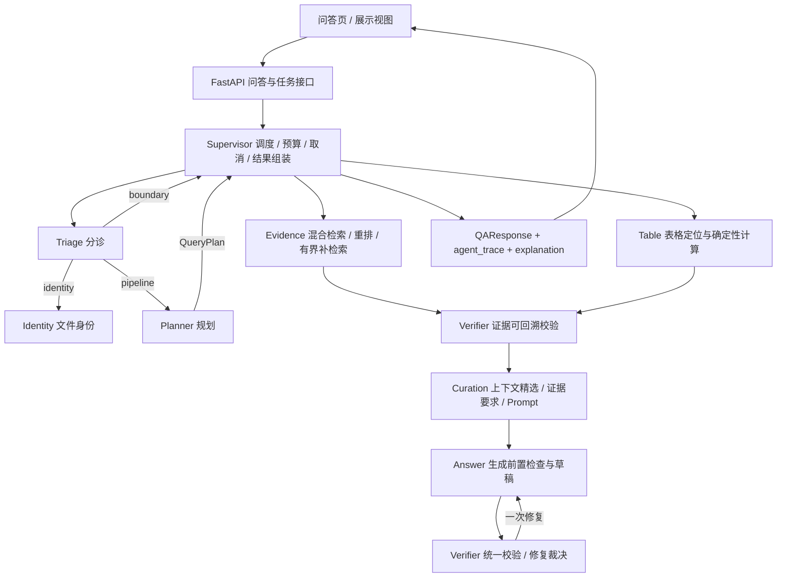

# ReguMate 参赛版技术说明

本说明与当前代码一致，重点解释本轮回答主链修正、展示视图、运行预算和验收结果。这里的“参赛版”不是另起一套系统：它沿用现有的 Supervisor＋专业 Agent 架构、检索索引、表格计算和验证服务，只整合已有能力并把真实执行过程展示出来。

## 1. 目标与边界

- 回答能力优先：普通问题 150 秒，复杂问题 240 秒，单请求最多 5 次模型调用。
- 保留多 Agent 架构，不增加大型技术体系，不引入新的生成入口。
- 展示数据由已有 `QueryPlan`、`EvidenceBundle`、claims、citations、`ValidationReport` 和进度事件投影生成，新增模型调用数为 0。
- 本轮不重跑官方 300 题或旧 200 题，不更新全量正确率；只运行 12 个核心用例和 6 个演示用例的稳定性记录。

## 2. 四项展示主张与实际支撑

| 展示主张 | 代码中的实际支撑 | 评委看到的内容 |
| --- | --- | --- |
| 多智能体分工协作 | `backend/app/services/agents/` 中的 Supervisor、Triage、Planner、Table、Evidence、Verifier、Curation、Answer；`agent_trace` 记录角色、任务、尝试、耗时、模型调用和方面数 | 任务如何拆分，每个角色实际完成什么，是否重试或跳过 |
| 跨文档证据组织 | `evidence_contract_service.py` 的来源标题约束、`requirements_for_plan` 的逐来源要求、跨文档拆分与去重、定义句保留 | 每份文件提供了什么依据，哪一侧来源或属性缺失 |
| 可复核的数据计算 | 表格单元格定位、`calculation_cells`、公式、结果、单位和操作数绑定；`formula_parser_service` 与 `answer_generation_service` 的确定性校验 | 指标、期间、单位、坐标、操作数、公式和结果 |
| 答案与依据联合核验 | `answer_validation_service.validation_passed` 统一要求 `status=passed`、`passed`、`citation_integrity`、`facts_supported`、`task_complete` 同时为真 | 引用可定位、事实支持、要求完整性分别展示，不再由各组件自行判断“可信” |

## 3. 架构

三层职责：

- **Supervisor**：路由、预算、取消、最终结果组装；本身不调用模型。
- **业务服务**：检索、计算、证据整编、验证；保留原有确定性逻辑。
- **Agent**：执行对应任务并记录输入输出摘要、状态、耗时和模型调用数。

调度仍然是串行和有界的；两个任务同时提交时保留排队和执行状态，不强求 GPU 推理并行。

## 4. 回答主链修正

### 4.1 统一成功作答标准

- 删除“模型拒答后由选择题相似度兜底直接写入事实支持、校验通过”的路径。选项相关证据仍用于检索和一次重新生成，但重新生成的答案必须走统一校验。
- 文本结论只有在 `ValidationReport` 的完整条件全部为真时才视为通过；相似度只用于找候选证据。
- 表格和公式继续使用确定性计算与校验；文本结论使用引用、事实和任务完整性联合校验。
- 正常文本路径规划、生成、验证三次模型调用；最多一次修复和复核；失败传输也占用调用次数，全请求上限 5 次。
- 模型拒答、证据缺失、计算输入不足、校验失败和服务故障分别保留结果类型：`model_refusal`、`evidence_missing`、`calculation_gap`、`validation_failed`、`service_error`。

### 4.2 减少误拒答

- 删除“没有提供金额”“没有指定”等孤立措辞直接触发入口拒答的规则。
- 缺少计算输入只在用户确实请求计算、公式所需变量确实无法取得时，由公式路径报告。
- “资料缺失时制度要求如何处理”之类问题正常进入规划和检索。
- 合并阶段表述（例如“恢复或处置阶段”）按原文直接回答，不要求拆出原文并未分别规定的阶段。

### 4.3 跨文档规划与证据完整性

- 每个命名来源保留独立的来源约束；比较任务本身是回答任务，不额外生成重复取证义务。
- 同一来源、同一属性、同一目标的重复拆分会被去掉；同一来源的不同引文条件不会被误删。
- 属性词、定义句式和章节标题用于定位和排序，不作为硬性证据筛除条件。
- 来源不符、必要结构被截断、操作数不足仍会阻止确定性结论；语义支持交给最终校验。
- 每个必需来源的上下文和定义句有保留机制：先保留来源证据，再扩展长章节；定义要求会从同一已召回文档中保留定义句，不扩大召回范围。

## 5. 展示视图与接口

问答页保留日常问答布局，新增“展示视图”切换。两种视图使用同一份回答、同一请求、同一检索结果，不改变回答策略。

三个区域：

1. **顶部任务区**：原问题、用户要求与来源约束、实际 Agent 分工、当前状态、时间预算、实际耗时、首个反馈时间、模型调用数。
2. **主体结论区**：主要结论、逐条 claim、跨文档来源并列、计算操作数到结果的完整过程。
3. **侧边依据区**：来源文件、章节或工作表/单元格、原文摘录、引用可定位状态、对应的要求与结论。

点击一条结论会同时高亮其证据和匹配的计算记录；点击证据会定位到使用它的结论。关系来自记录本身，不由模型另行编写解释。

接口最小扩展：`QAResponse.explanation` 为可选字段，由 `backend/app/services/answer_explanation_service.py` 本地投影生成，包含：

- 用户要求与来源约束；
- 要求、claim 索引与证据标识的对应关系；
- 计算操作数、公式、结果及来源；
- `ValidationReport` 的四项条件；
- 预算类别、总预算、实际耗时、模型调用数和首个反馈时间；
- 阶段状态与耗时。

展示数据不依赖 `include_debug`，不包含提示词、凭据或模型内部思考。后台任务沿用现有结果 JSON，旧记录缺少展示信息时前端显示“未记录”，不会自动重新提问。

## 6. 时间预算

- `QA_REQUEST_TOTAL_BUDGET_SECONDS` 默认 150 秒。
- `QA_COMPLEX_REQUEST_TOTAL_BUDGET_SECONDS` 默认 240 秒。
- `QA_MODEL_CALL_LIMIT` 默认 5。

QueryPlan 形成后，满足任一条件归为复杂任务：

- 至少两个不同的必需来源；
- 同时需要制度文本与表格证据；
- 至少三个用户明确要求的独立事项。

升级只发生一次，并以请求最初开始时间计算截止时间；重新检索、修复、嵌套调用和任务恢复都不会重新起算。HTTP、SSE、后台任务和 `qa_execution` 共享同一个预算状态；后台任务持久化 `started_at`、`category`、`total_seconds` 和已用调用数。

## 7. 验收与结果

- 基线与最终版使用同一组 12 个核心用例：每类两个，覆盖制度查询、跨文档比较、表格取数、表格计算、制度与数据联合问答、证据不足或澄清。
- 基线为 9/12；最终版首轮为 12/12；6 个演示用例在最终版各运行 3 次，全部通过。
- 计划内真实请求共 36 次：基线 12 次＋最终版首轮 12 次＋演示补跑 12 次。
- 历史演示结果和中间修复记录已清理；以下验收数字仅保留为历史技术记录。
- 后端测试：`679 passed, 2 skipped`；前端测试：`58 passed`；前端类型检查、构建和 lint 通过。
- 反硬编码扫描：125 个生产文件，0 findings（辅助检查，不替代换实体/换文档测试）。
- 本轮没有生成新的全量正确率，也不把 6 个演示案例的成绩称为独立泛化成绩。

## 8. 已知限制

- 同一工作表存在多个同名行板块时，问题未给出工作表、机构或口径，系统会拒绝猜测；这属于必要的澄清边界。
- 语义核验依赖在线模型，仍可能出现服务异常或输出截断；系统会保留错误类型，不把服务超时改写成知识不足。
- 表格取数/计算的确定性路径通常不调用生成模型，因此展示的模型调用数可能为 0 或 1；这与实际执行一致，不强行补足“3 次”。
- 本组结果来自当前单机 GPU 环境和当前知识库，不代表全部监管资料的泛化成绩。

## 9. 代码入口

- 统一问答入口：`backend/app/services/rag_service.py::answer_question`
- 调度：`backend/app/services/agents/supervisor.py`
- 统一校验：`backend/app/services/answer_validation_service.py`
- 展示投影：`backend/app/services/answer_explanation_service.py`
- 跨文档证据：`backend/app/services/evidence_contract_service.py`、`backend/app/services/query_planner_service.py`
- 表格与公式：`backend/app/services/spreadsheet_retrieval_service.py`、`backend/app/services/formula_parser_service.py`
- 前端展示：`frontend/src/components/qa/ShowcaseView.tsx`
- 保留的核心用例定义：`docs/contest-version/core_cases.json`；正式评测仅使用官方 300 题。
- 运行器：`scripts/contest/run_core_cases.py`、`scripts/contest/preflight_contest.py`
- 统一打包：`scripts/build_delivery_package.ps1`（默认不包含本地模型与 Qdrant 运行数据；加 `-IncludeRuntimeData` 进入离线演示模式）；交付检查：`scripts/verify_delivery.ps1`
