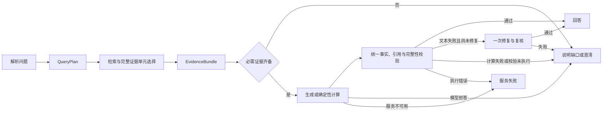

# ReguMate 主链简化

本轮把检索、计算和回答的依据收敛到同一份问题计划。证据不足、模型拒答、校验失败和服务故障均不能再通过摘录变成成功答案。本轮没有引入智能体调度、知识图谱、长期记忆、新数据库或新模型。

| 契约 | 含义 | 主要入口 |
| --- | --- | --- |
| QueryPlan | 原问题、独立事项、来源、主体限定、期间、单位、选择器和运算 | `plan_query`，明确表格问题由确定性语法与实际索引标签解析 |
| EvidenceBundle | 实际证据、要求对应关系、来源定位、缺口、选择记录及诊断 | `retrieve_evidence(db, query_plan)`，接受已有计划，可独立重放，不重新规划 |
| ValidationReport | 引用有效性、事实支持、任务完整性、状态与失败原因 | `validate_answer`，文本使用一次模型验收；表格与公式使用确定性校验 |

一次表格运算中的每个显式操作数都有独立要求。其证据绑定来自确定性单元格匹配及运算记录，不能由模型补出。跨文件运算还必须在上下文和答案引用中保留每份来源。三个操作数只找到两个时停止计算。

EvidenceBundle 的齐备状态表示当前要求已找到可定位的候选证据；最终结论仍须通过 ValidationReport。相关文本、重排高分、引文存在或某个旧布尔值都不能单独证明任务完成。

问题中的明确来源、期间和主体优先。模型拆分子问题时新增的元数据不能升级成硬筛选条件。按用户 2026-10-18 的补充要求，轻微歧义允许使用统一合理默认值并显示口径；影响关键事实且不能合理处理的歧义返回澄清。未明确季度的时间占位标签按实际表格顺序取值，变化计算默认同一实际行的首末季度，排除月度列，不固定列号。指标、机构行和报表名称优先来自当前索引；删除固定业务分项、报表名称模板、规划业务案例及机构拒答名单。保留单位、日期、运算、通用语法和文件身份规范化。

混合检索、重排、条款和定义索引、结构化表格索引继续使用。词面匹配用于排序和判断是否可以跳过补检索，不再因缺少提问用语否决强语义候选。每个事项最多一次有界补检索。结构化相邻引用不调用模型，也不递归扩展。

去重保留文档身份，不合并不同来源中的相同文本。上下文保留完整源块、列表、条件、例外和计算操作数；必需单元超过预算时记录缺口。最终覆盖关系从 EvidenceBundle 投影，删除另一套词面覆盖判断。候选记录区分未召回、元数据筛除、重排限制、上下文未选入和最终验收失败。

表格行列词汇来自当前所指材料的实际索引，文件名、工作表名称和日期不再变成取数指标。通用数量短语允许匹配真实标签的片段；机构行和指标、转置表的期间和列分别保留。补检索给已有片段增加更明确的证据角色时，由同一去重逻辑处理，不能按片段编号提前丢掉补证记录。

选择题列表可按用户选项中的枚举项目在指定来源内取证。实际章节标题与选项中的列表范围一致时，保留完整章节；只用于证明目录项目的标题按标题事实保留。来源格式也是身份的一部分，PDF 与 Word 不能静默替代。

文本选择题不再用近似选项评分恢复答案，也不因精确选项文本命中跳过验证。实际条目和确定其归属关系的上位标题正文共同进入证据；答案同时引用关系所需的源块。默认只展示所选结论与必要依据，用户明确要求逐项解释时才输出逐项判断，所有输出仍接受统一验证。生成与验证共享语义支持标准，但这并不保证模型能正确处理所有概括；本轮 Q234 仍保留失败。

定义取证保留完整源块，避免无关的相邻编号词条挤掉另一个必需定义。PDF/Word 表格行与同表表头、前置口径说明共同进入上下文。初次直接定位得到的部分证据即使不足以提前结束检索，也保留在混合检索结果中；不重复执行同一次选项查找。

最大、最小比较保留全部选项的实际单元格，不再按固定业务指标名排除候选；单位不一致时停止直接比较。官方九道比较题的标准答案与原始附件数值冲突，用户已明确同意按原表回答、保留失分并单独举证，详见 [原表数值核对](mainline-refactor/official-value-conflicts.md)。原评分器、题面及标准答案均保持原样，不把这些题移出分母。

文本正常路径至多三次模型调用：规划、生成、统一校验。最多一次修复和一次复核，全请求至多五次，失败的传输尝试也消耗次数。请求总期限同时约束普通、流式和后台入口；锁等待和嵌套阶段不能重置期限。表格和公式不使用生成模型猜测数值。

删除规划、生成、语义校验各自的阶段超时配置，传输只使用同一请求的剩余总预算。生成与验收复用既有输出额度配置，默认上限为 8192 token，包含现有模型的内部推理；保持 `.env` 中模型、凭据及思考开关原值。达到上限仍没有完整结构化结果时，不能作为成功回答。

后台任务将已用调用数和首次执行时间保存在原有任务进度 JSON 中，在发起模型请求前落盘。重启恢复保留剩余次数和期限，不修改数据库结构。预算记录放在已有阶段的 summary 扩展字段中，保持旧进度契约可读；当前产品隐藏该内部记录，不增加新阶段。已执行但缺少预算记录的旧任务不能假设尚未消耗预算，会明确失败并提示重新提问；已完成旧记录仍可读取，缺少校验状态时显示“未记录”。

| 结果 | 对外表现 |
| --- | --- |
| 回答 | 校验状态为 passed，引用、事实支持和完整性均确认 |
| 澄清 | `answer_type=clarification`，保留 `refused=true` 兼容旧接口 |
| 依据不足或合理拒答 | 明确缺口；相关材料可展示；不恢复为成功摘录 |
| 服务失败 | `answer_type=service_error` 或接口/任务失败，不能伪装为知识不足 |
| 校验关闭、未执行或旧记录缺状态 | 不显示为已核验 |

既有问答、检索、流式和任务端点及请求参数保留。流式草稿不提前标为核验答案；后台取消、幂等创建和有预算的任务恢复继续保留。前端按结果类别及完整校验状态展示，不按相似度或单个布尔值显示“可信”。

实际移除的默认能力包括 HyDE、独立模型检索审查、模型隐式引用识别、拒答转成功摘录、多轮证据绑定生成、重复摘录修复、部分 JSON 恢复和静默引用重定向。被撤下的实现保存在 Git 与历史实验记录中，不留自动兜底入口。历史消融协议应在其记录的 Git 版本运行；当前代码明确拒绝使用已移除模块的旧实验协议。

删除明细及被替换的私有机制测试记录见同目录清单。官方数据、官方评分器、旧 200 题题面与评分规则没有修改。新增机制测试覆盖换实体、换来源、不同版本、完整列表、缺操作数、拒答保留、未执行校验、失败传输计数和重启预算。

验收必须同时查看冻结代码身份、官方 300、旧 200 配对归因、封存 40 首次结果及固定开发子集的调用和延迟对照。反硬编码扫描的“零发现”只表示禁止模式未命中，还需要人工复核领域分支、静态词表及换实体、换文档测试。

下一阶段可以复用上述三个契约及独立检索、计算和校验入口。当前不提供智能体编排或共享记忆。模型语义验收仍存在误判可能；40 题仅支持有限的泛化判断。未明确的运算范围和不受支持的公式应澄清或拒答。
